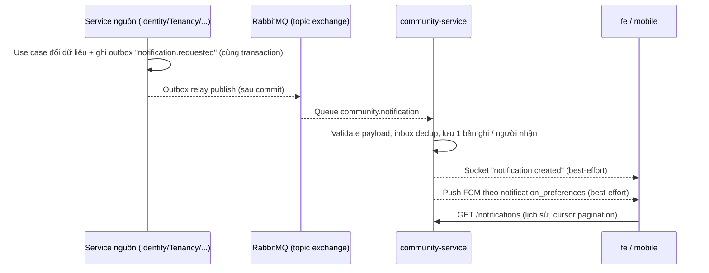

# Thông báo nghiệp vụ (notification)

Tài liệu này là quy ước chung cho mọi service muốn gửi thông báo tới người dùng
(Identity, Tenancy, community, …) và cho client hiển thị chúng (fe, mobile).
Chat **không** đi qua luồng này: tin nhắn có lịch sử riêng và chỉ gửi push.

## 1. Luồng tổng quát



- Bảng `notifications` là **nguồn sự thật** và là lịch sử thông báo; không có job xóa định kỳ.
  Socket/push gửi thất bại chỉ ghi log, người dùng vẫn thấy thông báo khi mở danh sách.
- Inbox (`processed_events`) và unique index `(sourceService, eventId, recipientUserId)`
  đảm bảo một event bị giao lặp chỉ tạo bản ghi một lần.

## 2. Payload `notification.requested`

Routing key và `eventType` đều là `notification.requested`. Validator:
`src/modules/notification/presentation/messaging/notification-requested.integration-event.ts`.

```json
{
  "sourceService": "tenancy-service",
  "recipientUserIds": ["<uuid>", "<uuid>"],
  "notification": {
    "type": "system",
    "title": "BUILDING_APPROVED_TITLE",
    "body": "BUILDING_APPROVED_BODY",
    "deepLink": "/buildings/<buildingId>",
    "data": {
      "messageKey": "building.approved",
      "buildingId": "<buildingId>",
      "buildingName": "Sunrise",
      "note": null
    }
  }
}
```

| Trường | Bắt buộc | Quy ước |
|---|---|---|
| `sourceService` | có | Tên service nguồn, ≤ 100 ký tự (`identity`, `tenancy-service`, `community-service`). |
| `recipientUserIds` | có | UUID người nhận, ≥ 1. **Không** gửi cho chính người thực hiện thao tác. |
| `notification.type` | có | Một trong `invoice`, `issue`, `system`. Quyết định nhóm cài đặt push (`notification_preferences`). Không thêm type mới khi chưa có quyết định PM. |
| `notification.title` | có | ≤ 255 ký tự. Mã hằng số khai báo trong class constant của service nguồn (mẫu: `UserNotificationCodeConstant`, `ContractNotificationCodeConstant`), không viết câu hiển thị trong BE. Client dịch theo `messageKey`. |
| `notification.body` | có | ≤ 2000 ký tự, như `title`. |
| `notification.deepLink` | không | Đường dẫn **path** của web (không kèm origin), dùng làm dự phòng. Fe ưu tiên tự tính route từ `messageKey` + `data` theo vai trò (mục 4). |
| `notification.data.messageKey` | **có theo quy ước** | Khóa nội dung, dạng `<aggregate>.<hành động>` viết thường, ví dụ `building.approved`, `contract.member_left`. Community chỉ log warning nếu thiếu (chưa chặn). |
| `notification.data.*` | tùy `messageKey` | **Ảnh chụp đủ tham số để hiển thị lại sau này** (tên tòa, tên phòng, kỳ hóa đơn, lý do…) và các id cần để mở trang. Không dựa vào việc tra lại dữ liệu lúc hiển thị vì lịch sử có thể được xem sau nhiều tháng. |

## 3. Quy tắc cho service nguồn

1. Ghi event vào **outbox trong cùng transaction** với thay đổi nghiệp vụ (giống các domain event khác).
2. Mỗi lần gửi là một event mới có `id` riêng; không tái dùng `id` giữa hai lần thông báo khác nhau.
3. Tự xác định người nhận trong service nguồn (service đó sở hữu dữ liệu). Community chỉ lọc thêm
   cho `issue.*` (bỏ người không còn thuộc hợp đồng).
4. Không đưa dữ liệu nhạy cảm (số tài khoản, token, số điện thoại đầy đủ) vào `title`, `body`, `data`.

## 4. Hiển thị phía client

- **fe**: registry `src/features/notifications/utils/notification-registry.ts` ánh xạ
  `messageKey → { i18n title/body, tham số, route theo vai trò }`. `messageKey` chưa có trong
  registry thì hiển thị `title`/`body` như server gửi.
  Thứ tự chọn trang khi bấm: route của registry → `deepLink` (cùng origin) → `/notifications`.
- **mobile**: hiện hiển thị `title`/`body` như server gửi; dịch theo `messageKey` là việc sau.

## 5. Danh sách `messageKey`

| `messageKey` | Service nguồn | `type` | Người nhận | `data` (ngoài `messageKey`) | Trạng thái |
|---|---|---|---|---|---|
| `issue.created` / `issue.updated` / `issue.cancelled` | community-service | `issue` | Landlord + thành viên hợp đồng (trừ người thao tác) | `issueId`, `contractId` | Đã có |
| `match_request.created` / `.accepted` / `.rejected` / `.withdrawn` | tenancy-service (community dựng nội dung) | `system` | Bên còn lại | `matchRequestId`, `actorUserId`, `actorDisplayName`, `status` | Đã có |
| `invoice.issued` | tenancy-service | `invoice` | Tenant của hợp đồng | `invoiceId`, `contractId`, `period` | Có gửi, thiếu `messageKey` (P12-03) |
| `user.locked` / `user.unlocked` | identity | `system` | Người bị khóa / mở khóa | `userId`, `status`, `lockedAt` | Có gửi, thiếu `messageKey` nên Web hiện mã (P12-02) |
| `contract.suspended`, `contract.lock_decision_required`, `contract.restored`, `contract.terminated_by_lock` | tenancy-service | `system` | Theo luồng khóa landlord | `contractId`, … | Có gửi, thiếu `messageKey` nên Web hiện mã (P12-03) |
| `building.approved` / `building.rejected` | tenancy-service | `system` | Landlord của tòa | `buildingId`, `buildingName`, `note` | Kế hoạch (P12-04) |
| `building.pending_review` | tenancy-service | `system` | Admin | `buildingId`, `buildingName`, `landlordName` | Kế hoạch (P12-05) |
| `invoice.voided` | tenancy-service | `invoice` | Tenant của hợp đồng | `invoiceId`, `period`, `reason` | Kế hoạch (P12-06) |
| `contract.activated`, `contract.checked_out` | tenancy-service | `system` | Tenant và thành viên hợp đồng | `contractId`, `contractCode`, `roomName`, `buildingName`, … | Kế hoạch (P12-07) |
| `contract.member_added`, `contract.member_linked`, `contract.member_left` | tenancy-service | `system` | Theo từng sự kiện | `contractId`, `contractCode`, `memberName`, … | Kế hoạch (P12-08) |

Khi thêm hoặc đổi một `messageKey`, cập nhật bảng này trong cùng PR.

## 6. Checklist thêm một thông báo mới

- [ ] Service nguồn: event `notification.requested` theo mục 2, ghi outbox cùng transaction.
- [ ] Unit test payload: có `messageKey`, đủ tham số, `title`/`body` lấy từ class constant, đúng người nhận.
- [ ] fe: thêm mục vào registry + key i18n `vi`/`en` trong `notifications.json`.
- [ ] Cập nhật bảng mục 5 của tài liệu này.
- [ ] Chạy tay: thao tác → có bản ghi trong `notifications` → toast trên web → bấm mở đúng trang
      → F5 lại `/notifications` vẫn hiển thị đúng cả `vi` và `en`.
